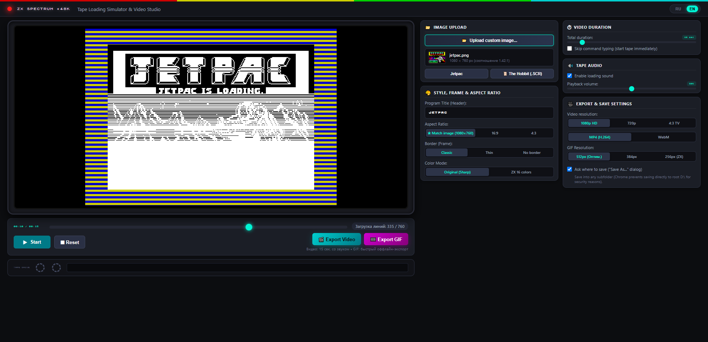

# 🕹️ ZX Spectrum Tape Loading Simulator & Video Studio

**English** | [Русский](README.md)

> [!TIP]
> ### 🌐 Run Online in One Click:
> ## 👉 **[mrtek.github.io/ZX-Loading-Simulator](https://mrtek.github.io/ZX-Loading-Simulator/)** 👈
> Launch right in your browser without downloading or installing anything!



An interactive simulation and video studio for generating authentic tape loading videos of images on the legendary **ZX Spectrum 48K** computer.

**100% Standalone Single Page Application**: runs entirely in the client-side browser. Does not require Node.js, Python, FFmpeg, or any backend servers.

---

## 🚀 How to Run

### 🌐 Option 1. Online in Browser (Instant Launch)
Simply open the link:
### 🔗 **[https://mrtek.github.io/ZX-Loading-Simulator/](https://mrtek.github.io/ZX-Loading-Simulator/)**

---

### 💻 Option 2. Locally on Your Computer (Offline)
Download the repository archive or clone it, then simply **double-click the file**:
```
index.html
```
or drag and drop it into any web browser window.

### 🌐 Browser Compatibility:
- **Google Chrome** (Windows, macOS, Linux)
- **Microsoft Edge** (Windows, macOS)
- **Mozilla Firefox** (Windows, macOS, Linux)
- **Opera** (Windows, macOS, Linux)
- **Apple Safari** (macOS, iOS / iPadOS)

All fonts, audio synthesizers, and algorithms are embedded directly into the project. The application works completely offline without an internet connection.

---

## ✨ Features

1. **Load Any Image (Drag & Drop or File Picker)**:
   - Supports PNG, JPEG, WEBP, GIF, and native ZX Spectrum **.SCR** screen dumps (6912 bytes).
   - **Dynamic Aspect Ratio**: video and screen adapt automatically to your image proportions (e.g., widescreen 1024×546, 16:9, 4:3, or 1:1).
   - **100% pixel-perfect sharpness**: nearest-neighbor rendering with no artificial blur, dark scanline bands, or noise degradation.
   - **Display Modes**:
     - **Original (Sharp)**: preserves original image colors with progressive ZX Spectrum interlaced loading.
     - **ZX 16 Colors**: authentic 15-color Sinclair retro palette.
   - **Border Options**:
     - **Classic** / **Thin**: authentic border with tape loading stripes around the picture.
     - **No Border**: the image fills the entire frame.

2. **Authentic Two-Phase ZX Spectrum Loading**:
   - **Phase 1: Monochrome Bitmap**: scanlines load progressively with Spectrum's unique interlaced order (three screen thirds, 8-pixel character blocks).
   - **Phase 2: Color Attributes**: once the bitmap is complete, the color attribute layer smoothly fills the screen from top to bottom (the iconic Spectrum color reveal).

3. **Authentic Tape Sound Synthesis (Web Audio API)**:
   - Pilot tone (~806.3 Hz), sync pulses (~2.4 kHz), data transfer chitter, and the final Sinclair Beep (~930 Hz).
   - Animated audio oscilloscope and rotating tape reels (*Tape Drive*).
   - Volume control and mute toggle.

4. **Bilingual Interface (RU / EN)**:
   - Language switch in the top-right corner of the interface: `[ RU | EN ]`.
   - **Russian by default**.
   - Language selection is remembered in browser storage (`localStorage`).

5. **Precise Duration Control (3 to 120 seconds)**:
   - All loading phases scale dynamically to match the chosen duration:
     - `LOAD ""` command typing on the classic white Sinclair screen with `© 1982 Sinclair Research Ltd`.
     - Header pilot tone (Cyan & Red border stripes).
     - Header data block (`Program: <NAME>`, Yellow & Blue stripes).
     - Inter-block tape pause.
     - Screen data pilot tone.
     - Monochrome interlaced bitmap drawing.
     - Color attribute overlay.
     - Final Sinclair Beep tone and ready screen (0 OK).
   - **"Skip command typing"** option: jumps straight to tape loading.

6. **In-Browser Video Export (MP4 / WebM)**:
   - **Cross-browser recording**: exports universal **MP4 (H.264 / AAC)** in Chrome, Edge, and Safari, and high-quality **WebM** in Firefox.
   - **Resolutions**: 1080p Full HD, 720p HD, 4:3 TV.
   - **Saving**:
     - When *"Ask where to save"* is enabled, opens the standard system "Save As..." dialog (in supported browsers).
     - Alternatively, downloads the file directly to your browser's Downloads folder.

---
