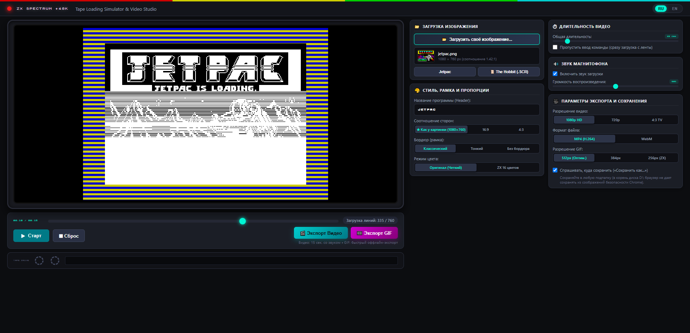
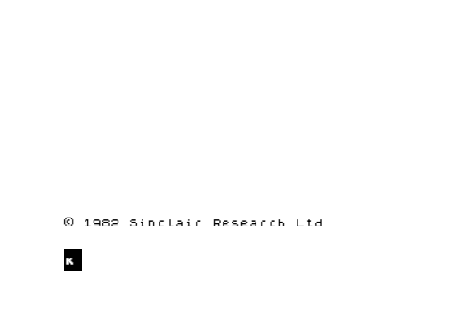

# 🕹️ ZX Spectrum Tape Loading Simulator & Video Studio

[English](README.en.md) | **Русский**

> [!TIP]
> ### 🌐 Онлайн-версия в один клик:
> ## 👉 **[mrtek.github.io/ZX-Loading-Simulator](https://mrtek.github.io/ZX-Loading-Simulator/)** 👈
> Запускайте прямо в браузере без скачивания и установки!



Интерактивная программа-студия для генерации аутентичных видео и GIF-анимаций загрузки картинок на легендарном компьютере **ZX Spectrum 48K** с магнитофонной кассеты.

**100% автономное веб-приложение (Standalone Single Page Application)**: работает полностью в браузере на стороне клиента. Не требует установки Node.js, Python, FFmpeg или каких-либо серверов.

---

## 🚀 Запуск программы

### 🌐 Способ 1. Онлайн в браузере (быстрый старт)
Просто перейдите по ссылке:
### 🔗 **[https://mrtek.github.io/ZX-Loading-Simulator/](https://mrtek.github.io/ZX-Loading-Simulator/)**

---

### 💻 Способ 2. Локально на компьютере (оффлайн)
Скачайте архив проекта или клонируйте репозиторий, затем просто **дважды щелкните по файлу**:
```
index.html
```
или перетащите его в окно любого браузера.

### 🌐 Совместимость с браузерами:
- **Google Chrome** (Windows, macOS, Linux)
- **Microsoft Edge** (Windows, macOS)
- **Mozilla Firefox** (Windows, macOS, Linux)
- **Opera** (Windows, macOS, Linux)
- **Apple Safari** (macOS, iOS / iPadOS)

Все шрифты, звуки и алгоритмы встроены в проект. Программа работает даже без подключения к интернету (полностью оффлайн).

---

## ✨ Возможности студии

1. **Загрузка любого изображения (Drag & Drop или кнопка Обзор)**:
   - Поддержка форматов PNG, JPEG, WEBP, GIF, а также оригинальных экранов **.SCR** (6912 байт).
   - **Динамическое соотношение сторон**: видео и экран автоматически подстраиваются под пропорции вашей картинки (например, широкоформатный дракон 1024×546, 16:9, 4:3 или 1:1).
   - **100% резкость без замыливания**: рендеринг пиксель-в-пиксель (nearest-neighbor) без искусственных затемняющих полос и шумов.
   - **Режимы отображения**:
     - **Оригинал (Четкий)**: сохранение оригинальных цветов картинки с пошаговой чересстрочной загрузкой ZX Spectrum.
     - **ZX 16 цветов**: аутентичная 15-цветовая ретро-палитра Sinclair.
   - **Настройки бордюра**:
     - **Классический** / **Тонкий**: аутентичная рамка с цветными полосами кассеты вокруг картинки.
     - **Без бордюра**: картинка заполняет весь кадр целиком.

2. **Аутентичная двухэтапная загрузка ZX Spectrum**:
   - **Фаза 1: Черно-белый растр**: строки изображения загружаются сверху вниз с характерным чересстрочным шагом экрана Spectrum (по блокам 8px в каждой из 3 третей экрана).
   - **Фаза 2: Наложение атрибутов цвета**: после завершения прорисовки всех строк, цветной слой атрибутов плавно и эффектно «заливает» картинку сверху вниз построчно (знакомый всем спектрумистам эффект проявления цветов).

3. **Синтез аутентичного звука кассеты (Web Audio API)**:
   - Пилот-тон ~806.3 Гц, синхроимпульсы ~2.4 кГц, скрежет передачи данных, финальный Sinclair Beep ~930 Гц.
   - Анимированный осциллограф звуковой волны и вращающиеся катушки магнитофона (*Tape Drive*).
   - Регулировка громкости и выключатель звука.

4. **Двуязычный интерфейс (Bilingual RU / EN)**:
   - Переключатель языка в правом верхнем углу интерфейса: `[ RU | EN ]`.
   - **Русский язык по умолчанию**.
   - Выбор языка сохраняется в памяти браузера (`localStorage`).

5. **Точная настройка длительности (от 3 до 120 секунд)**:
   - Все фазы загрузки автоматически масштабируются под выбранную длительность:
     - Ввод команды `LOAD ""` на чистом белом экране Sinclair с текстом `© 1982 Sinclair Research Ltd`.
     - Заголовочный пилот-тон (полосы Cyan & Red на бордюре).
     - Блок данных заголовка (`Program: <ИМЯ>`, полосы Yellow & Blue).
     - Межблочная пауза ленты.
     - Пилот-тон блока данных экрана.
     - Черно-белая растровой прорисовка.
     - Наложение цветных атрибутов.
     - Финальный сигнал Sinclair Beep и экран готовности (0 OK).
   - Опция **«Пропустить ввод команды»**: сразу переходит к загрузке с кассеты.

6. **Экспорт видео в браузере (MP4 / WebM)**:
   - **Кроссбраузерная запись**: в Chrome, Edge и Safari экспортирует универсальный **MP4 (H.264 / AAC)**, в Firefox — высококачественный **WebM**.
   - **Разрешения**: 1080p Full HD, 720p HD, 4:3 TV.
   - **Сохранение**:
     - При включенной опции *«Спрашивать, куда сохранить»* открывается стандартный диалог проводника «Сохранить как...» (в поддерживаемых браузерах).
     - Либо файл автоматически скачивается в папку «Загрузки» браузера.

7. **Экспорт в анимированный GIF (100% автономно)**:
   - **Быстрый оффлайн-рендеринг**: просчет кадров выполняется без ожидания реального времени прямо в браузере (15-секундная симуляция кодируется за 1-2 секунды).
   - **Разрешения на выбор**: 512px (оптимальное), 384px (компактное), 256px (оригинальный пиксельный масштаб ZX Spectrum).
   - **Автоматическое зацикливание**: бесконечный цикл воспроизведения (loop) для вставки в презентации, блоги или соцсети.
   - **Компактный размер**: благодаря блочной структуре экрана ZX Spectrum результирующий GIF занимает всего ~200 КБ – 1 МБ.
   - **Сохранение**: поддержка диалога «Сохранить как...» или прямое скачивание с защитой от ограничений браузера.

   <p align="center">
     
   </p>

---
